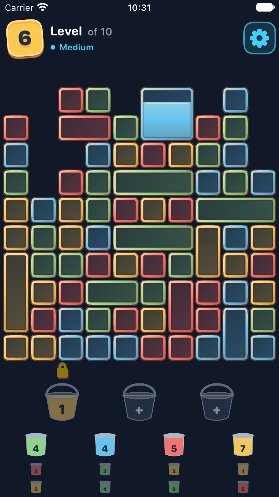
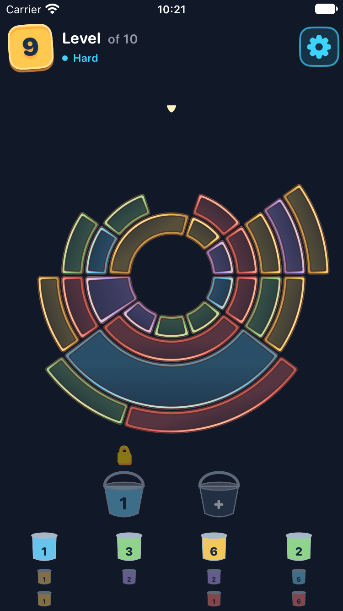

# Color Flow

An offline iPhone puzzle game for iOS 17+. The ten-level prototype alternates square 10 × 10 boards with circular boards of ten lanes and five bands, starting with a circle. Fill matching containers while managing active buckets and four reserve queues. Full containers disappear; unsupported containers settle downward on squares and inward on circles. Circular boards rotate counterclockwise beneath a fixed centered pour. Paint inside arcs always forms a concentric band expanding outward from the inner edge, independent of screen gravity.

Levels 1–4 are easy, 5–8 medium, and 9–10 hard. Difficulty is provisional pending playtesting. Circular searches begin at the lane beneath the fixed pour pointer and continue clockwise, restarting from each newly aligned lane. Version-6 saves preserve settled boards and alignment. Updating from versions 4 or 5 restarts at level one while retaining lifetime statistics.

## Gameplay

Cozy Enamel gameplay captured on the iPhone SE third-generation simulator, iOS 27.2 (375 × 667 points). Both videos contain 30 seconds of normal-speed gameplay. Click play in the table to watch inline on GitHub.

| Board | Gameplay screenshot | Gameplay video |
| --- | --- | --- |
| Square |  | <video src="https://github.com/user-attachments/assets/8ff2c919-a3bd-4a24-93f5-2391d37793bd" width="240" controls></video> |
| Circular |  | <video src="https://github.com/user-attachments/assets/b512a62c-d05f-48e4-b67c-3355429b2cc6" width="240" controls></video> |

The primary compact-device target is iPhone SE (second generation), including iOS 17.1.1. See the [visual style guide](DESIGN.md), [game design](docs/game-design.md), and [validation status](docs/validation.md).

## First setup

Full Xcode is required; Command Line Tools alone do not include the iOS software development kit (SDK) and Simulator. Installation and device connection should be completed interactively with the agent, one verified step at a time.

1. Install stable Xcode compatible with your macOS and iOS 17 device debugging. Open it, review Apple's license, and finish required-component installation.
2. In Xcode → Settings → Components, install an iOS Simulator runtime. Select Xcode → Settings → Locations → Command Line Tools if the active toolchain is incorrect. Verify with `xcodebuild -version` and `xcodebuild -checkFirstLaunchStatus`.
3. Open `ColorFlow.xcodeproj`. In Window → Devices and Simulators (Device Hub in newer Xcode), create an iPhone SE simulator with an available compatible runtime. An SE third-generation simulator has the same 375 × 667-point layout. If the runtime no longer supports an SE simulator, install an older runtime supported by Xcode. Do not update the physical SE to accommodate a simulator runtime.
4. Select the ColorFlow scheme and simulator, then Run. No development team is needed for Simulator.

If Xcode fails at launch with `_XPCTypeBool` in an old `/Library/Developer/PrivateFrameworks/CoreDevice.framework`, inspect the framework version and crash output first. A stale shared developer framework installation can survive an Xcode reinstall. Move the affected directory to a uniquely named backup with administrator authorization, reopen Xcode, and let first-launch setup reinstall components. Do not delete system frameworks or apply this workaround to unrelated launch errors.

## Connect your iPhone

1. Connect with a data-capable Lightning cable, unlock the phone, and accept **Trust This Computer** on the phone.
2. Select the phone in Xcode's device manager and wait for pairing to complete.
3. Enable **Settings → Privacy & Security → Developer Mode** on the phone; restart and confirm. The setting may appear only after pairing begins.
4. In Settings → Developer on the phone, enable **Enable UI Automation** and accept any approval prompt. For longer test sessions, temporarily set Settings → Display & Brightness → Auto-Lock to Never (turn off Low Power Mode if that control is disabled).
5. Add your Apple Account in Xcode → Settings → Apple Accounts. A free Personal Team supports basic local device development; its provisioning profiles expire and may need renewal.
6. Copy `Config/Local.xcconfig.example` to `Config/Local.xcconfig`. Set your development team identifier and a unique bundle prefix. This file is ignored by Git. Let Xcode manage signing automatically for the app and test targets. Do not share passwords, verification codes, signing certificates, or device identifiers in pull requests.
7. Select your unlocked phone as the run destination and run the app. If iOS asks to trust the developer under Settings → General → VPN & Device Management, complete that step.
8. Run the simulator-and-device test command below. Keep the phone connected and unlocked during tests. The agent must inspect the resulting device test report before declaring setup verified.

## Tests

```sh
swift test -c release
swift run LevelCheck
python3 scripts/test_device_selection.py
python3 scripts/run-tests.py
```

Release mode keeps the algorithmic generation/search tests fast.

The final command runs all UI tests on the simulator and also runs the same suite on an available iPhone SE second generation. The runner reports an absent phone as skipped; during agent-led local validation, the agent must first ask you to connect a phone or explicitly approve skipping device tests. Trust, pairing, lock, signing, and execution failures are blockers. Tests use separate game-save files and never reset normal play progress.

A unique device identifier (UDID) selects a simulator or phone. Select specific destinations when necessary:

```sh
xcrun simctl list devices available
python3 scripts/run-tests.py --simulator SIMULATOR_UDID --device DEVICE_UDID
```

`SIMULATOR_UDID` and `DEVICE_UDID` environment variables provide the same overrides. Results are written to timestamped directories under `TestResults/`, with separate simulator/device `.xcresult` bundles. Open them in Xcode to inspect screenshots and failures. Do not commit raw results containing device identifiers.

The shared scheme uses automatic screenshots: Xcode 27.2 automatic video recording crashes the automation service on iOS 17.1.1. Preserve this setting when changing schemes; capture animation recordings separately.

Unit tests use Swift Testing; user interface (UI) tests use XCTest and operate the actual app through accessibility controls. The routine suite covers representative easy/medium/hard layouts, rectangular boxes, persistent partial fills, gravity, recharge, read-only board layout, restoration, restart, defeat/retry, animation interaction locking, reduced motion, and the splash on launch and background return. Campaign boundary tests check a fresh level one, completing it and advancing to level two, restoring that progress, completing the final level, and starting again with a fresh level one that persists across relaunch. They play only the first and last levels. Stats in Settings shows win percentage and average winning time for each difficulty. Core tests use fixed engine/search fixtures. `LevelCheck` separately audits every published winning path, losing alternative, and generation report.

Publish level replacements as a complete generated output set, then run `swift run -c release LevelCheck`. Its default audit replays stored proofs; `--solve` additionally searches for fresh paths, and `--write-solutions` recomputes the winning-path file. Generation metadata must remain consistent. Levels are generated offline; the app uses the same algorithmic solver for on-demand hints. See [level generation](docs/level-generation.md) for randomized generation, reproducible seeds, difficulty profiles, and safe campaign replacement. `python3 scripts/create-project.py` reproducibly updates Xcode target membership if app/test Swift files are added or removed.

## Pull request checks

[Pull request checks](.github/workflows/pull-request.yml) runs on every pull request, including new commits, and can also be started manually from Actions. Both jobs use macOS 15 with Xcode 16.4, which is included in the [GitHub runner image](https://github.com/actions/runner-images/blob/main/images/macos/macos-15-Readme.md).

- **Core tests** checks generated Xcode project consistency, runs release-mode core tests, audits all published level paths, and tests device selection.
- **iOS build and tests** builds the Release app for iOS without signing and runs all UI tests on an iPhone SE (third generation) simulator with iOS 18.5. Test reports are uploaded as `simulator-test-results` for one day, including on test failures.

After the first workflow run, select **Core tests** and **iOS build and tests** as required status checks in the target branch's GitHub ruleset or branch protection settings. Keep these job names stable. New commits cancel an older run for the same pull request. There are no path filters, so documentation-only pull requests also produce both checks.

Hosted checks run every local automated check that does not require a physical phone: project consistency, core tests, level audits, runner tests, and all simulator UI tests, including campaign boundaries. They require no signing secrets. Physical iOS 17 device runs remain separate local checks; if no phone is connected, the agent asks you to connect one or approve skipping them.

## Visual review and pull requests

For visible changes, capture and inspect relevant screenshots on the compact layout and a larger phone. Embed accessible images in the pull request (PR) description; include before/after images when changing existing UI. State device and OS. For pouring changes, include a short recording to show alignment, continuous flow, sequential filling/removal, column switching, and responsiveness. Keep images limited to game content.

Simulator capture examples (replace `booted` with an explicit simulator UDID when multiple simulators are running):

```sh
xcrun simctl io booted screenshot /tmp/color-flow.png
xcrun simctl io booted recordVideo /tmp/color-flow.mov
```

Stop recording with Control-C. UI tests also preserve selected screenshots as test-report attachments.

For the README table, run `testSquareGameplayMedia` or `testCircularGameplayMedia` from `ColorFlowUITests`. Each prepares an isolated checkpoint near a fall, relaunches at normal animation speed, and prints `GAMEPLAY_CAPTURE_READY` after the splash. Start recording at that marker, capture at least 30 seconds, and trim to exactly 30 seconds without changing playback speed. Inspect the screenshot and video, and verify duration with `ffprobe` before replacing the corresponding `docs/evidence/prototype-square.*` or `prototype-circular.*` files.

Upload selected evidence to the PR or an accessible artifact location; local filesystem links are not shareable PR evidence. Report capture/upload blockers honestly.

To refresh an inline player, upload the inspected MP4 as a GitHub attachment (for example, `gh pr edit PR_NUMBER --attach docs/evidence/prototype-circular.mp4`), then use its durable `https://github.com/user-attachments/assets/...` URL in the table's video element. Keep the repository MP4 source in sync and verify the rendered README contains a player with controls. Do not save GitHub's temporary signed playback URL. See [GitHub attachment guidance](https://docs.github.com/en/github-cli/github-cli/attaching-files-with-github-cli).
